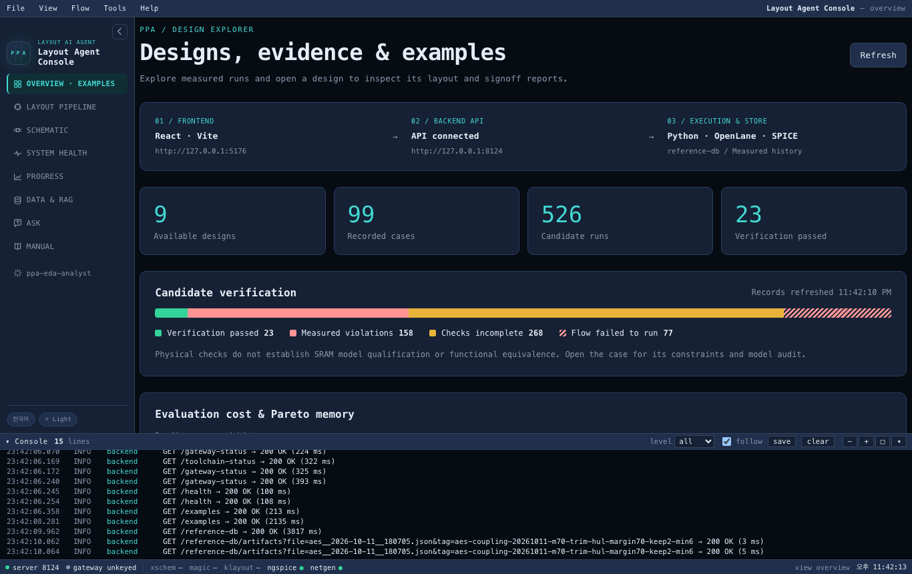
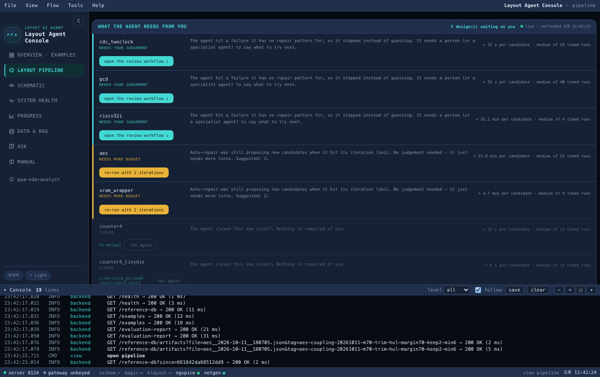
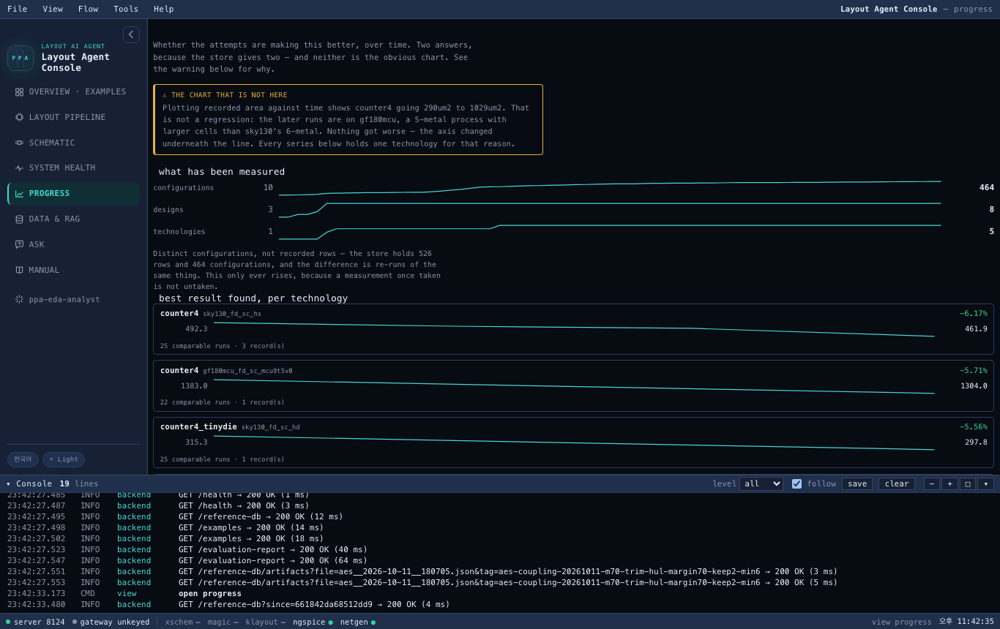

# ppa-eda-agent

A physical-design AI agent for semiconductor
PPA (Power, Performance, Area): it runs real RTL through real OpenLane2
placement/routing, evaluates the result against real signoff data, and
repairs what it can on its own. The dashboard is that agent's control
surface — trigger a real run and watch it work — not a static report
viewer.

Not related to [ppa-agent](https://github.com/kos2001/ppa-agent) (Ansible
Personal Package Archive tooling) despite the shared acronym — same three
letters, completely different domain (chip design vs. Linux packaging).

See [`soul.md`](soul.md) for the commitments behind this project — real
runs over mocked ones, documented dead-ends over hidden ones — before
diving into the components below.

## Quick start

Node 22.12+ and Python 3 are the only requirements for the dashboard and the
tests. From the repository root, in two terminals:

```sh
npm --prefix server start                                   # backend API on http://127.0.0.1:8123 (no npm dependencies)
```

```sh
npm --prefix dashboard ci
npm --prefix dashboard run dev -- --host 127.0.0.1 --port 5173 --strictPort
```

Open http://127.0.0.1:5173. The Overview and Layout Pipeline tabs read the
committed [`reference-db/`](reference-db/) case store, so the dashboard shows
real measured history without any EDA tool installed. Running a *new*
placement/routing candidate needs Docker, OpenLane 2 and the sky130 PDK — see
[Autonomous layout pipeline](#autonomous-layout-pipeline); a plan can be
validated without them:

```sh
python3 pipeline/orchestrator.py --design pipeline/designs/counter4 \
  --run-spec pipeline/designs/counter4/run_spec.json --validate-only
python3 -m unittest discover -s tests -v                    # pure decision-logic tests, no EDA tools
```

More: [Dashboard](#dashboard) (ports, `.env`, the Diagnosis page) and
[Tests](#tests).

## Screens

<table>
<tr>
<td></td>
<td></td>
</tr>
<tr>
<td><b>Overview · Examples</b> — 9 designs, 99 recorded cases, 526 candidate runs; the verification bar keeps "checks incomplete" and "flow failed" visible instead of folding them into a pass rate.</td>
<td><b>Layout Pipeline</b> — the agent's control surface: which designs stopped for a human judgement, which only need more iterations, and which it closed itself.</td>
</tr>
<tr>
<td></td>
<td></td>
</tr>
<tr>
<td><b>Progress</b> — best result per design and technology, with an explicit note on why the "obvious" area-over-time chart is not drawn.</td>
<td></td>
</tr>
</table>

All three screens are rendered from the committed <code>reference-db/</code>
case store (measured history from earlier OpenLane runs); no OpenLane run was
performed to capture them.

## Contents

- [Quick start](#quick-start)
- [Screens](#screens)
- [What's here](#whats-here)
- [Autonomous layout pipeline](#autonomous-layout-pipeline)
  - [Placement and routing decisions](#placement-and-routing-decisions)
  - [Retiring stored results](#retiring-stored-results)
  - [A second metrics source, and a dataset export](#a-second-metrics-source-and-a-dataset-export)
  - [Human-in-the-loop review + self-improvement loop](#human-in-the-loop-review--self-improvement-loop)
- [Tests](#tests)
- [MCP server](#mcp-server)
- [The custom/analog half (Virtuoso's counterpart)](#the-customanalog-half-virtuosos-counterpart)
  - [The layout pipeline's designs, as schematics](#the-layout-pipelines-designs-as-schematics)
  - [Opening a standard cell](#opening-a-standard-cell)
  - [A standard cell's layout, signed off and stored](#a-standard-cells-layout-signed-off-and-stored)
  - [The custom half's self-improvement loop](#the-custom-halfs-self-improvement-loop)
  - [On virtuoso-bridge-lite](#on-virtuoso-bridge-lite)
  - [Not done](#not-done)
- [Dashboard](#dashboard)
  - [Diagnosis page (live agent, via hermes-gateway)](#diagnosis-page-live-agent-via-hermes-gateway)

## What's here

```
AGENTS.md                           Repository-wide evidence, experiment,
                                     and validation rules for coding agents
.codex/skills/ppa-eda-flow/         Project skill for bounded, reproducible
                                     OpenLane experiment work
.claude/skills/ppa-eda-flow/        Byte-identical copy for Claude Code
                                     (tests/test_skill_mirror.py)
.claude/agents/ppa-eda-analyst.md   Claude Code subagent: diagnoses PPA
                                     issues from pasted/given report text
references/                         Report format knowledge the agent is
                                     built on:
  report-area.md                      Design Compiler report_area
  report-timing.md                    PrimeTime report_timing
  report-power.md                     PrimePower report_power
  see-also.md                         Real open-source examples (OpenSTA,
                                       Yosys) and documented format variants
server/index.mjs                    Local server for the dashboard: serves
                                     the reference-db case store, runs
                                     pipeline/orchestrator.py on demand and
                                     reports its progress
dashboard/                          React + Vite + TypeScript UI — the
                                     layout agent's control surface: trigger
                                     a real pipeline/orchestrator.py run
                                     and watch it live, browse past
                                     reference-db/ cases, open a schematic
docs/superpowers/                   Design specs and implementation plans
                                     from how this was built
pipeline/                           Autonomous layout pipeline: real
                                     placement/routing candidate
                                     generation and evaluation via
                                     OpenLane 2 + sky130 (see below)
pipeline/analog/                    Transistor-level cells for the custom
                                     flow (Virtuoso's counterpart), run by
                                     pipeline/custom_bridge.py against the
                                     PDK's own ngspice device models
reference-db/                       Case store of past pipeline runs —
                                     topology signature, candidate
                                     configs tried, real PPA/DRC/LVS
                                     results — for reuse across designs
  cases/                              one JSON per design per day
  layouts/                            real KLayout renders of each case's
                                       actual GDS, kept here so they
                                       outlive the (gitignored) run dirs
  reviews/                            human-in-the-loop review requests
```

## Autonomous layout pipeline

### LibreLane / OpenROAD upgrade comparison

`PPA_EDA_TOOLCHAIN=librelane` selects the installed, pinned
`ghcr.io/librelane/librelane:3.0.16` image and OpenROAD `dcf36133` (2026-02-17).
This is the latest LibreLane release verified on 2026-10-23, not the latest
OpenROAD master. `PPA_EDA_TOOLCHAIN=stable` retains OpenLane 2.3.10.
The LibreLane profile uses its own CLI and Python module and retains the
installed PDK with `--manual-pdk`. Existing custom OpenLane Python flows
require the stable profile; they are rejected explicitly under LibreLane.

The paired GF180 GCD comparison at 13.2 ns / utilization 38 is recorded in
`reference-db/gcd_toolchain_comparison_20261023.json`, with evidence under
`pipeline/designs/gcd/experiments/toolchain-upgrade-20261023/`.
The original stable PASS requires correction: OpenLane 2.3.10 divides the
integer derating value `5` by integer `100`, applying 0% instead of 5%.
LibreLane uses floating-point division. GCD now explicitly sets
`TIME_DERATING_CONSTRAINT: 5.0`; preserve the decimal and verify the generated
SDC contains early 0.95 / late 1.05. `resolved.json` alone is insufficient:
its serializer can display 5 even when the Tcl environment correctly has 5.0.

Three additional full-flow evaluations kept 13.2 ns, utilization 38, the
installed GF180 PDK, fanout 12 and all physical gates unchanged:

| Configuration | Actual derating | Worst setup (ns) | Setup violations | Slew violations | Cell area (um2) |
| --- | --- | ---: | ---: | ---: | ---: |
| Historical stable | 0% | +0.268 | 0 | 0 | 12104.3 |
| Corrected stable | 5% | -0.388 | 4 | 0 | 12110.9 |
| LibreLane, CTS cluster size/diameter 25/50 | 5% | -1.540 | 107 | 39 | 10187.9 |
| LibreLane, same CTS plus post-GRT timing repair | 5% | -1.358 | 80 | 39 | 10214.3 |

Explicit CTS 25/50 reproduced the original LibreLane result. Post-GRT timing
repair improved setup but did not close it or repair slew, so neither tuning
option was promoted to the base config. Recorded DRC/LVS and hold checks pass;
these are not overall timing passes. Workload power is 5.35 mW for corrected
stable and 4.91 mW for the tested LibreLane variants at ff/-40C/5.5V.

At synthesis, stable/new cell areas are 7957.6/6780.9728 um2. Pre-PnR worst
setup at 5% is -1.975/-1.820 ns; the final ordering reverses after physical
implementation. This compares bundled synthesis, STA and physical flows,
not OpenROAD alone. Functional equivalence was not requested or established.
Case provenance reports an unresolved host PDK path; retained resolved configs,
tool identities, stage states and final SDCs document this manual comparison.
The stable profile remains the default, but no tested profile is qualified
for 13.2 ns with the intended 5% margin. Historical raw cases remain unchanged;
the derived comparison marks their effective derating explicitly.

Compare `design__instance__area__stdcell`, not raw `design__instance__area`:
the newer OpenROAD total includes filler area. Historical raw case totals
remain unmodified; the comparison explicitly records both definitions.


### Tool-contract audit (2026-10-23)

The source and artifact audit covers the installed OpenLane 2.3.10 and
LibreLane 3.0.16 flow scripts, available raw runs, CLI input conversion,
final SDC, timing-corner coverage, and metric scoring. It does not certify
OpenROAD/Yosys/OpenSTA algorithms or all PDK/device models.

`reference-db/tool_contract_audit_20261023.json` records all 25 available
run directories across the workspace and upgrade worktree. There are 21
derating mismatches and 22 missing synthesis input-driver diagnostics;
these overlap. Three runs pass these contract checks, which is not a
physical signoff PASS. Original historical case verdicts are preserved;
consult the audit before reusing them as qualified references.

Confirmed findings and protections:

- Old default-SDC derating performs integer division. Explicit integer
  clock/percentage inputs are now formatted as decimals at the CLI boundary.
  Inherited defaults are not guessed; a final-SDC mismatch blocks PASS.
- Old Yosys/ABC receives `cell/pin` as the driving-cell name and emits
  `Cannot find the default PI driving cell`. The actual log confirms the
  driver was ignored. Such a result now fails the input-contract gate,
  including the corrected-derating stable comparison. LibreLane strips the
  pin name. The old installed image itself has not been patched.
- Both base SDC versions can truncate I/O delay when all operands are
  integers (13 * 20 / 100 = 2, versus the intended 2.6 ns). The new optional
  CTS delay-buffer percentage also uses `/ 100`. A Tcl probe reproduces the
  arithmetic; CTS was disabled for the GCD comparisons, so this is a latent
  option issue, not an observed GCD cause. Explicit values are normalized.
- Scoring uses standard-cell area when available, retains raw instance area,
  and uses the same definition for the cell-area budget. Invalid numeric
  slack/counts and negative WS cannot hide behind zero aggregate WNS.
- Final scalar constraints and every requested setup/hold corner are checked
  before PASS. Missing artifacts and custom SDC intent remain unverified.
- Launch verifies the installed OpenROAD revision, runs the inspected image
  ID, archives runtime identity, and rejects ignored design-config keys as
  well as ignored CLI overrides.

Remaining boundaries: the default activity-power helper on main is SKY130
specific; the GCD comparison explicitly used its archived GF180 evaluator.
Automatic PDK provenance has unresolved host-path coverage in these cases.
Arbitrary custom SDC semantics, analog/model characterization, pad-ring
arithmetic, and tool-internal algorithms need separate validation. No new
13.2 ns / 5% timing closure or universally bug-free toolchain is claimed.

Validation: the initial 1536-test suite exposed five mock-boundary errors
and nine PDK-path failures/errors. After correcting mocks and connecting the
installed PDK in this worktree, all 167 tests in affected/failed modules pass.
A fresh LibreLane full flow passes the new tool-contract audit and correctly
remains FAIL with 107 setup and 39 slew violations. See the archived
`tool-audit-20261023/validation.json`; no second full-suite pass is claimed.

Re-audit retained runs without changing history:

```sh
python3 pipeline/tool_contract_audit.py pipeline/designs/gcd/runs/<tag>
python3 -m unittest discover -s tests -p test_tool_contract_audit.py
```

### Explicit implementation evidence and PPA budgets

The [Build-A-Chip-Bench announcement](https://chipagents.ai/newsroom/chipagents-nvidia-build-a-chip-bench)
and [research](https://chipagents.ai/research/build-a-chip-bench) separate functional
and physical qualification from PPA ranking. Applying that principle locally,
`run_spec.json` now accepts the following optional contract (merge into an
existing spec with candidates):

```json
{
  "require_implementation_evidence": true,
  "targets": {
    "max_cell_area_um2": 1000,
    "max_core_area_um2": 2000,
    "max_die_area_um2": 3000,
    "max_power_w": 0.01,
    "max_clock_period_ns": 10
  }
}
```

These numbers illustrate the schema, not measured or recommended design limits.
Budgets are inclusive upper bounds. Missing, negative or nonfinite measurements
block qualification; invalid limits are rejected before launching a flow.
Power uses OpenSTA's `power__total` **vectorless estimate**, not workload power.
The clock budget requires the period in the run's `resolved.json`, so a repair
that relaxes the clock cannot silently evade the original requirement. Existing
setup/hold and physical signoff checks still apply.

`require_implementation_evidence` automatically runs the existing Yosys checker
for every completed candidate, including repair and polish candidates, and
requires a non-vacuous proof and a nonempty final `.gds` file before selection.
The CLI equivalent is `--require-implementation-evidence`. `verify_function: true`
also enables equivalence checking through run specs, including dashboard runs.
Without strict mode, legacy selection stays compatible but missing evidence is
explicitly recorded. Candidate details show evidence and each declared budget;
historical cases are marked as not recorded rather than retroactively certified.

This is **not** the official benchmark or a tapeout certificate. The existing
checker normally compares RTL with the synthesis netlist; it does not prove the
workload specification or independently verify post-route functional behavior.
GDS file presence is not a format-validity check; physical correctness still
depends on the recorded signoff checks. A separate optional simulation gate now
checks post-route behavior and a Python oracle for counter4, described below.
Hidden VIP, formal post-route equivalence, isolated grading, and normalized benchmark
scores remain outside this implementation. No published task constraints or
reference scores are represented as results from this repository.

Verified on 2026-10-23 through Ubuntu WSL, Docker 29.7.2 and the pinned
OpenLane 2.3.10 image using
[`run_spec_implementation_check.json`](pipeline/designs/counter4/run_spec_implementation_check.json).
The [recorded counter4 case](reference-db/cases/counter4__2026-10-23.json)
passed all 23 recorded signoff counts, proved all four synthesis equivalence
points, and produced a final GDS. Cell/core/die areas were 290.278 / 480.461 /
1455.83 um2; vectorless power was 95.4963 uW at a 10 ns configured period.
The example budgets above are smoke-test bounds, not a PPA optimization result.
From the repository root in PowerShell, run via the installed WSL environment:

```powershell
wsl -d Ubuntu -- python3 pipeline/orchestrator.py --design pipeline/designs/counter4 --run-spec pipeline/designs/counter4/run_spec_implementation_check.json --max-parallel 1
```

Choose a fresh candidate tag in the spec to preserve an earlier run's artifacts.
Docker need not be installed on the Windows PATH when it is available in WSL.

### Verilator functional regression

`functional_regression` in a run spec enables a mandatory local RTL simulation
gate for completed candidates, including repair and polish trials. Counter4's
default run spec enables it. The runner reads the design's configured
`VERILOG_FILES` (`dir::` files/globs), snapshots them with the testbench, and
records SHA-256 hashes, tool version, compile logs, seed logs and check counts
under each run's `_functional_regression/` directory. The verdict and dashboard
show the result. No previous candidate's pass is reused.

```json
"functional_regression": {
  "oracle": "counter4",
  "post_route": true,
  "top": "counter4_regression",
  "testbench": "verify/counter4_regression.sv",
  "seeds": [1, 17, 101],
  "compile_timeout_s": 300,
  "simulation_timeout_s": 30
}
```

The testbench must call `$fatal` on a mismatch and print exactly one
`PPA_REGRESSION_PASS checks=N` line, with positive N, only after all checks
complete. Verilator runs with `--binary --timing --assert`; successful process
exit without this completion marker is unverified. Compile failures, missing
inputs and timeouts block selection as unverified; simulation failures reject
the candidate. Timeouts remove the specific Docker container as well as stopping
the client. Each seed receives `+seed=N` and Verilator's random-seed argument.

The existing OpenLane image lacks make for building simulations. Pull the
upstream functional-simulation image once before running:

```powershell
wsl -d Ubuntu -- docker pull verilator/verilator:v5.018
```

Run the regression against the current RTL and an existing completed physical
run (without rerunning P&R):

```powershell
wsl -d Ubuntu -- python3 pipeline/functional_regression.py --design pipeline/designs/counter4 --run-dir pipeline/designs/counter4/runs/functional-regression-20261023 --run-spec pipeline/designs/counter4/run_spec.json
```

Counter4 checks reset, enable hold, wrap-around, reset-over-enable priority and
seeded mixed traffic. With `oracle: "counter4"`, the host's independent Python
model validates every `PPA_TRACE` cycle, expected input sequence and output,
rather than trusting the HDL scoreboard's PASS. The model requires all 322
canonical cycles per seed; truncated, reordered or unknown traces cannot pass.
The Python model's hash is recorded alongside the source hashes.

With `post_route: true`, Icarus Verilog in the pinned OpenLane image simulates
`final/nl/<DESIGN_NAME>.nl.v` with the exact `CELL_VERILOG_MODELS` paths from
that run's `resolved.json`. Missing final netlists never fall back to synthesis
netlists. The same testbench, seeds and optional oracle check RTL and final
netlist separately; either failure or missing evidence blocks selection.
Netlist and cell-model snapshots/hashes are retained with the reports.

This is zero-delay functional simulation (`FUNCTIONAL`, `UNIT_DELAY=#0`),
not SDF timing simulation, hidden VIP or a proof of all input sequences.
The local oracle is editable by the same developer; it is independently
implemented but not isolated from the agent. Other designs need their own
self-checking testbench and, optionally, a registered Python oracle. Include paths,
macro models and HDL defines are not yet inferred from OpenLane configuration;
declared include directories and defines are rejected as unverified, and missing
macro simulation requires an explicit behavioral model for every configured macro
(synthesis blackboxes are rejected). Simulation is checked after the physical flow, so this version does not
yet save P&R time by rejecting broken RTL before synthesis.

Live WSL validation on 2026-10-23 with upstream Verilator 5.018 passed
322 checks for each of seeds 1, 17 and 101 (966 checks total). Deliberate
increment-by-two and wrong-reset-priority mutants both compiled and failed with
actual scoreboard mismatches on all three seeds. These are two negative
controls, not an exhaustive mutation-coverage claim. See the
[mutation results](reference-db/validation/verilator-counter4-mutations-20261023.json).
Reproduce them without changing the original design:

```powershell
wsl -d Ubuntu -- python3 tests/check_counter4_mutations.py --report reference-db/validation/verilator-counter4-mutations.json
```

Additional live controls prove that the Python oracle rejects an increment-by-two
RTL even when the HDL scoreboard is disabled and prints PASS, and that a swapped
final-netlist output fails post-route simulation while its unchanged RTL passes.
See [verification-layer controls](reference-db/validation/counter4-verification-layers-20261023.json).
Reproduce against a completed counter4 physical run:

```powershell
wsl -d Ubuntu -- python3 tests/check_counter4_verification_layers.py --run-dir pipeline/designs/counter4/runs/functional-regression-20261023 --report reference-db/validation/counter4-verification-layers.json
```

### SRAM functional regression

[`sram_wrapper/run_spec_functional_check.json`](pipeline/designs/sram_wrapper/run_spec_functional_check.json)
connects the installed OpenRAM behavioral model through `macro_models` and
enables `rtl_cell_models` because this wrapper instantiates real sky130 address
buffers. The mapping names the macro module and its `/pdk/` Verilog model;
the runner requires all declared macros to be mapped and hashes/snapshots each
model. It never uses the synthesis blackbox as a behavioral substitute.
Post-route simulation uses the final netlist and recorded standard-cell models
with the same explicitly selected SRAM model.

```powershell
wsl -d Ubuntu -- python3 pipeline/orchestrator.py --design pipeline/designs/sram_wrapper --run-spec pipeline/designs/sram_wrapper/run_spec_functional_check.json --max-parallel 1
```

The `sram_wrapper` Python oracle follows the macro's rising-edge input latches,
falling-edge memory operations, wrapper output registers, and SRAM contents
retained across wrapper reset. Each seed runs 800 cycles with address wraps,
directed resets and seeded resets. This wrapper writes only even addresses and
reads odd addresses on port 0, so **port 0 has no defined read data**. Unwritten
addresses and same-address concurrent write/read cases are reported as excluded,
not passing assertions. The dashboard distinguishes trace-cycle counts from
actual checked outputs and reports undefined counts per port.

This tests the existing wrapper's observable defined behavior, not all memory
features: its write mask is tied high, so byte-mask coverage is not claimed.
The vendor model's arbitrary functional delay is retained; this is not SPICE,
SDF timing signoff or proof that the relaxed SRAM liberty is characterized.
Physical violations/model validity still block overall qualification even when
functional simulation passes.

The live negative control corrupts bit 8 of every write in a separate RTL copy;
all three seeds must fail the Python oracle despite successful simulation exits:

```powershell
wsl -d Ubuntu -- python3 tests/check_sram_mutation.py --report reference-db/validation/sram-corrupt-write.json
```

The [2026-10-23 SRAM run](reference-db/cases/sram_wrapper__2026-10-23__014811.json)
completed real placement/routing, GDS generation and signoff. RTL and final-netlist
simulation each ran 2,400 trace cycles and compared 1,190 defined port-1 outputs;
both passed. The [corrupted-write control](reference-db/validation/sram-corrupt-write-20261023.json)
failed the Python oracle for all three seeds. Magic/KLayout DRC and LVS reported
zero errors, but overall qualification **failed**: 16 max-slew and 18 max-fanout
violations, plus 27 macro pins outside the liberty characterization range.
The worst was `u_sram/web0`, 0.460 ns against a 0.040 ns characterized limit.
No timing limits were relaxed for this test. Formal RTL/synthesis equivalence
was not enabled for this macro run; the functional evidence is simulation.

Custom Python flows now mount the resolved PDK directory explicitly because
the WSL installation's absolute `pdk/sky130A` symlink otherwise dangles inside
Docker. This run used the existing design constraints and the original PDK.

The generated `reference-db/cases/*.json` files use compact JSON. The
2026-09-16 whitespace-only migration reduced 70 cases from 607,317,687 to
198,697,128 bytes (67.28%) while preserving every string, numeric spelling,
key, and array order against the previous Git revision. Existing JSON
readers and file paths are unchanged. Case creation and updates share
`pipeline/case_storage.py` so later reviews and runs retain the smaller format.
Use `python3 pipeline/case_storage.py` to preview savings and add `--write`
to compact existing cases atomically. For readable inspection, use
`python3 -m json.tool reference-db/cases/<case>.json`.

Beyond reading reports, this repo can now drive a real
RTL → placement → routing → signoff loop and evaluate the candidates it
produces — see
`docs/superpowers/specs/2026-08-21-autonomous-layout-agent-design.md` for
the full design and
`.claude/agents/{circuit-layout-extractor,topology-analyst,
placement-strategist,physical-constraint-evaluator,
routing-candidate-evaluator,verification-ppa-evaluator,
feedback-optimizer}.md` for the subagents that reason about it.

Requires Docker and a local sky130 PDK (fetched once via `volare`, see
the spec doc). Standard-cell-only, digital designs for now — no SRAM
bitcell layout yet (see the spec's "Known limitations").

Validate a plan before starting Docker or any EDA tool:

```sh
python3 pipeline/orchestrator.py --design pipeline/designs/counter4 \
  --run-spec pipeline/designs/counter4/run_spec.json --validate-only
```

This checks sweep structure, normalized tag collisions, duplicate
override/PDK/SCL configurations, positive iteration counts, and the optional
`candidate_budget`. It prints the maximum initial candidate count and its
sources. A completed case records the same `search_plan` beside its metrics.

```sh
cd pipeline
python3 orchestrator.py --design designs/counter4 \
  --run-spec designs/counter4/run_spec.json \
  --max-parallel 3
```

Or trigger the same real run from the dashboard's Layout Pipeline tab
("run agent now") — `server/index.mjs`'s `POST /pipeline/run
{"design": "counter4"}` spawns `orchestrator.py` server-side and `GET
/pipeline/run-status?design=counter4` reports its live status (running/
done/error) plus a tail of its real stdout/stderr, which the tab polls
until the run finishes and the new `reference-db/` case appears. This is
the difference between the dashboard being a viewer of past runs and
being the agent's actual control surface — see `soul.md`.

`run_spec.json`'s `candidates` can be listed by hand, and/or generated
via a `sweeps` entry — `{"param": "FP_CORE_UTIL", "values": [25, 35,
45, 55, 65], "tag_prefix": "sweep-util"}` expands to one candidate per
value (`orchestrator.py`'s `expand_sweeps()` — a small, dependency-free
idea borrowed from the OpenROAD Project's own
[AutoTuner](https://github.com/The-OpenROAD-Project/OpenROAD-flow-scripts/blob/master/docs/user/InstructionsForAutoTuner.md),
without pulling in its full Ray/hyperopt search machinery, which this
pipeline's scale doesn't need yet — see the design spec's "Borrowed
from prior art" section). New searches should also declare
`candidate_budget` plus `search.mode`, `search.objective`,
`search.reference`, and `search.seed` when randomized. Every candidate runs
through a real OpenLane
flow, concurrently when `--max-parallel` is greater than 1 (keep the
default of 1 on memory-limited machines), scored against the spec's
targets using OpenLane's own real `metrics.json`
(DRC/LVS/timing/power/area), and written to `reference-db/`. If nothing
passes, it auto-repairs the one real failure mode it knows how to (an
`OpenROAD.GeneratePDN` power-grid failure from utilization pushed too
high — steps `FP_CORE_UTIL` down and retries) for up to
`max_iterations` before handing off to `feedback-optimizer` for
anything it can't pattern-match on. Validated for real:
`designs/counter4/run_spec.json`'s utilization sweep (25–65%, run with
`--max-parallel 3`) found the same real PDN strap-width boundary as
before — 25/35 pass, 45+ fails.
`reference-db/cases/counter4__2026-08-21.json` has the current result.

A third design (`pipeline/designs/counter4_tinydie`) validates a *second*
auto-repairable failure pattern — a die started too small even for
floorplan margins, repaired by growing `DIE_AREA` instead of lowering
utilization — converging for real across 4 automatic iterations (8x8um →
64x64um → clean pass). Along the way it caught a real bug in how list-
valued overrides (like `DIE_AREA`) were serialized for OpenLane's CLI;
see `reference-db/cases/counter4_tinydie__2026-08-21.json`.

A second, macro-heavy design (`pipeline/designs/sram_wrapper`, wrapping a
real sky130 SRAM hard macro) hits a different real constraint — the
macro's own liberty file specifies a max_transition on its address/mask
input buses tighter than the strongest resizer-available buffer can meet
even at zero wire length — documented with full diagnosis (including a
correction of an earlier, unverified guess) in
`reference-db/cases/sram_wrapper__2026-08-21.json`. Left open rather than
forced past; see the design spec's "Second vertical slice" section.

`pipeline/recharacterise.py` traces where that 0.04 ns comes from, and
it is not a limit the SRAM imposes: OpenRAM's default `slew_scales`
`[0.25, 1, 8]` times sky130's `rise_time` 0.005 ns is exactly the
`index_1` axis in the macro's own liberty. The number records where
characterisation stopped. So raising `max_transition` in the .lib (as
this design's `.relaxed.lib` does) is extrapolation rather than a fix,
and is anyway short of the 0.209 ns this design actually reaches — 5.2x
the ceiling. Closing it means characterising the macro over the slew
range it will really see, which [OpenRAM](https://github.com/VLSIDA/OpenRAM)
exposes as `slew_scales` and
[sky130_sram_macros](https://github.com/VLSIDA/sky130_sram_macros)
regenerates from. The module reports the ceiling, its source, how far
past it a run sits and the grid that would cover it; it does not run
OpenRAM, since regeneration is a SPICE sweep of hours producing a new
GDS/LEF/lib set that has to be verified before anything trusts it.

### Throughput scoring for RTL variants

[`throughput_score.py`](pipeline/throughput_score.py) scores microarchitecture
rewrites the way OpenAI's
[Advancing chip design with OpenAI models](https://openai.com/index/advancing-chip-design-with-our-models/)
(2026-11-18) scored its RISC-V RTL-optimization task. Knob candidates are judged
at a fixed `CLOCK_PERIOD`, so cycles per instruction never change. That breaks
down for RTL rewrites. A 2-cycle multiplier made 1-cycle, or a re-staged
pipeline, trades cycles for cycle time. Area alone can't rank such changes, and
neither can slack. Instructions per second can.

- **Zero score** if the functional check did not pass, a required feature is
  absent, any workload failed, no held-out workload was measured, Fmax is
  missing, or cell area exceeds `max_area_ratio` × the measured baseline
  (default 16×, as in the article).
- **Throughput** is the geometric mean of IPC over **held-out** workloads only,
  multiplied by Fmax. Workloads visible to the optimizer never count.
- **Normalization**: the best throughput observed under the same constraints
  scores 1.0. Pass `reference_best_mips` to keep scores comparable across
  batches. Means **include zero-scored runs**, overall and per `group` (for
  example, per agent budget or strategy). A strategy that is fast when it works
  but often breaks the design therefore can't look better than it is.

The scorer departs from the article in two places. Both follow the article's
own limitations section:

- **Fmax comes from post-route STA**: `1000 / (CLOCK_PERIOD − timing__setup__ws)`.
  The article used a Yosys estimate. Pre-layout estimates are accepted only when
  labelled `pre_layout_estimate`, and the report's scope then says so.
- **`required_features` blocks feature dropping.** Leaving out performance
  counters or extra instructions is the article's explanation for why cores
  written from a spec out-scored rewrites of the existing cores.

To produce the counts, a testbench prints one line per workload:
`PPA_PERF workload=<name> instructions=<N> cycles=<M>`.
`functional_regression.py` records these counters (only from passing seeds) as
`perf` on each seed run. `run_from_artifacts()` turns a regression result plus
`metrics.json` into one evidence run, summing counts across seeds. A held-out
workload that was never measured scores zero; it is never imputed.

```powershell
python pipeline/throughput_score.py evidence.json --report throughput.json
```

The same relative cap is available as a run-spec gate in
`implementation_contract`:
`"targets": {"max_area_ratio_vs_baseline": 16, "baseline_cell_area_um2": <measured>}`.
A ratio without a measured baseline is rejected.

#### Measured: riscv32i (2026-11-19)

[`riscv_workloads.py`](pipeline/riscv_workloads.py) supplies the workloads. It
holds a two-pass RV32I assembler and an ISA simulator written from the spec,
independently of the RTL. It generates
[`verify/riscv_perf_tb.sv`](pipeline/designs/riscv32i/verify/riscv_perf_tb.sv).
That bench drives the synthesized `riscv` block directly and `$fatal`s on any
memory-signature mismatch. For each workload it prints
`PPA_PERF` with the ISA simulator's architectural instruction count and the
cycles the RTL took. There are six workloads:

- **Visible:** `sum64` and `fib40`.
- **Held out:** `bubble24`, `mul16`, `popcount32` and `checksum96`.

Each runs on seeds 1, 17 and 101, which gives 116 signature checks per seed.

[`throughput_from_runs.py`](pipeline/throughput_from_runs.py) reran the RTL
(Verilator 5.018) and each run's own post-route netlist (Icarus 12) on seven
completed sky130 runs. All runs are `CLOCK_PERIOD` 23.6 ns. Read-only run
directories are copied with SHA-256 hashes first. The post-route cycle counts
must equal the RTL counts. Report:
[`riscv32i-throughput-20261119.json`](reference-db/validation/riscv32i-throughput-20261119.json).

| run | held-out IPC | post-route Fmax | MIPS | area vs AREA-0 | score |
|---|---|---|---|---|---|
| iter3-area3-clk23p6-slew1p5-fanout16 | 1.000 | 44.96 MHz | 44.96 | 1.093× | 1.000 |
| graph-r1-1-design_repair_max_cap_pct | 1.000 | 43.78 MHz | 43.78 | 1.094× | 0.974 |
| graph-r1-1-fp_core_util | 1.000 | 43.35 MHz | 43.35 | 1.085× | 0.964 |
| iter2-area3-clk23p6-postgrt | 1.000 | 43.31 MHz | 43.31 | 1.115× | 0.963 |
| iter3-area3-clk23p6-slew1p5 | 1.000 | 43.31 MHz | 43.31 | 1.114× | 0.963 |
| graph-r1-1-max_fanout_constraint | 1.000 | 43.17 MHz | 43.17 | 1.095× | 0.960 |
| iter2-area0-clk23p6-postgrt | 1.000 | 39.59 MHz | 39.59 | 1.000× | 0.881 |

7/7 runs pass, and the mean score is 0.958 with zeros included. The IPC is
exactly 1 because this is a single-cycle core. That is a measured result, not
an assumption: every workload's RTL cycle count equals its ISS instruction
count, on RTL and on all seven netlists. So for these knob-only variants the
ranking is purely post-route Fmax. The AREA-0 run is the smallest. It is also
the slowest: it misses 23.6 ns by 1.66 ns, which gives 25.26 ns achieved. The
area-ratio gate does not bind here (the largest run is 1.115×). An RTL rewrite
that changes CPI is the case this scorer is built for, and none has been
measured yet. The baseline is the AREA-0 run, which the report records; it is
not an "original core" from upstream.

Negative controls, RTL only, all three seeds:

- An AND→OR ALU mutant fails on `mul16`.
- An inverted-SLT mutant fails on `checksum96`.

Both fail with real signature mismatches. The workloads exercise only the RV32I
subset the assembler emits (ALU and immediates, `lw`/`sw`, `beq`/`bne`/`blt`/
`bge`, `lui`, `jal`). This is not a compliance suite. For example, an OR→XOR
mutant would survive `checksum96`, because its two shifted operands never
overlap. Held-out means the counts are left out of the optimizer's feedback. It
is not isolation from the agent: the bench is local and editable.

Regenerate the bench and remeasure (WSL):

```powershell
python pipeline/riscv_workloads.py --out pipeline/designs/riscv32i/verify/riscv_perf_tb.sv
wsl -d Ubuntu -- python3 pipeline/throughput_from_runs.py --design pipeline/designs/riscv32i --run-spec pipeline/designs/riscv32i/run_spec_throughput.json --baseline-run <AREA-0 run> --stage-dir /tmp/riscv32i-throughput-stage --report reference-db/validation/riscv32i-throughput.json <run dirs...>
```

### What other open-source chip agents contribute (2026-11-19 survey)

Projects checked, and what (if anything) this repository adopts from each:

| Project | What it is | Adopted here |
|---|---|---|
| [ORFS-agent](https://arxiv.org/html/2506.08332v3) (UCSD ABKGroup, v3 2026; [code](https://github.com/ABKGroup/ORFS-Agent/tree/journal-todaes-handoff)) | An LLM that tunes up to 12 ORFS knobs. It runs K=25 parallel runs per iteration, and its tools include a GP surrogate with a Matérn kernel and Expected Improvement, a Latin hypercube sampler, and diversity selectors (EntropySelect/GraphSelect). It reports +1.0% WL, +1.3% ECP and +2.6% co-optimization over OR-AutoTuner, with 40% fewer iterations. Objectives are normalized to the default-flow baseline and aggregated as a geometric mean over designs. Area and power must stay within ±2–4% of baseline. | **The batch step**, as `batch_design.py`: a Latin hypercube pool, then greedy maximin selection of K points away from configurations already recorded. **Not** the GP + EI step: `surrogate.py` measured that the store can't yet support a fitted model. The relative constraint is covered by `max_area_ratio_vs_baseline`. |
| [OpenROAD AutoTuner](https://github.com/The-OpenROAD-Project/OpenROAD-flow-scripts/tree/master/tools/AutoTuner) | Ray Tune plus hyperopt/Optuna Bayesian search over ORFS parameters. It is ORFS-agent's baseline. | Already cited in `expand_sweeps`, which borrows its declarative sweep shape. Space-filling seeding is now available through `design_of_experiments`. |
| [ORAssistant](https://arxiv.org/abs/2410.03845) | A RAG assistant over OpenROAD documentation. | Not adopted. Retrieval here is grounded in measured cases (`case_retrieval.py`), not in docs. |
| [MCP4EDA](https://www.arxiv.org/abs/2507.19570) | An MCP server for Yosys, Icarus, OpenLane and KLayout, with synthesis tuning driven by backend data. The authors report 15–30% timing and 10–20% area improvement over default synthesis. | Already covered: `pipeline/mcp_server.py` exposes the flow over MCP, and `SynthesisExploration` screening feeds backend-measured results. |
| [AuDoPEDA](https://arxiv.org/abs/2601.06268), Helix, [GR-Evolve](https://arxiv.org/html/2604.22234v1) | Coding agents that edit OpenROAD's C++ (placer, router) and re-evaluate QoR. AuDoPEDA reports up to 5.9% less routed wirelength. | Out of scope. This repository treats the tools as fixed evaluators and changes only design inputs. |
| [ChipAgents](https://www.hpcwire.com/off-the-wire/chipagents-expands-full-stack-agentic-ai-across-digital-and-analog-chip-design) | A commercial front-end platform (RTL, verification, debug). It reports 155/156 on VerilogEval-Human (vendor figure). No code is public. | Nothing to adopt. Its verification-first emphasis matches the functional gates already here. |

`design_of_experiments` in a run spec adds a fixed-size, space-filling batch to
the candidates. `expand_sweeps` expands it, so every caller gets it, including
`rank_candidates.py`:

```json
"design_of_experiments": {
  "space": {"FP_CORE_UTIL": {"low": 30, "high": 60, "type": "int"},
            "CLOCK_PERIOD": {"low": 18.0, "high": 26.0, "type": "float", "digits": 1},
            "SYNTH_STRATEGY": {"values": ["AREA 0", "AREA 3", "DELAY 1"]}},
  "batch": 6, "pool": 200, "seed": 7, "tag_prefix": "doe"
}
```

Dry expansion against the real store for riscv32i (8 recorded configurations)
proposed six candidates. Each is at least 0.897 (normalized distance) from
every recorded configuration, and their minimum pairwise spacing is 0.872.
None of the six has been run through OpenLane yet. Whether space-filling beats
the sweep on regret is the question `search_strategy.py` measures; it can only
answer it once these runs are recorded.

### Statistical recovery memory (after ChipMEM)

[`recovery_memory.py`](pipeline/recovery_memory.py) applies the statistical
memory from
[ChipMEM: Verification-Grounded Memory for EDA Agents](https://arxiv.org/abs/2609.27067)
(AlRabah et al., 2026; [code](https://github.com/aalrabah/ChipMEM)) to this
store's repair history. ChipMEM ranks recovery actions for an error class with
nested Beta-binomial estimates. It starts from Beta(1,1), and each level shrinks
toward its parent: `p_j = (s_j + K·p_{j-1}) / (s_j + f_j + K)`, with `K = 8`.
Here the levels are:

1. the violation signature;
2. the signature and the override key;
3. the signature, the override key and its value.

One observation is one recorded transition: a knob changed between two
consecutive measured runs, and a signature present before either closed or
persisted. A second hierarchy, over key and then key/value, estimates the
regression risk. `closed_loop_search.plan()` now attaches a `recovery_estimate`
to each candidate and ranks candidates by `P(close any current violation) −
P(regress)`. Generating candidates still requires closure evidence, repeats
are still refused, and proposals stay one knob at a time. Called without a
memory, `propose()` behaves as before.

**Held-out test.** Each of the 8 designs was held out in turn and its
transitions were predicted from the other designs:
[`recovery-memory-20261119.json`](reference-db/validation/recovery-memory-20261119.json).

| | Brier (all 507) | AUC (all 507) | Brier (326 single-knob) | AUC (326 single-knob) |
|---|---|---|---|---|
| hierarchical, K=8 | 0.241 | **0.640** | 0.229 | **0.654** |
| flat Laplace per (sig, key, value) | **0.237** | 0.607 | **0.228** | 0.652 |
| global base rate | 0.292 | — | 0.250 | — |
| previous score `closures − 2·regressions` | — | 0.417 | — | 0.551 |

The previous count score ranked held-out closures *worse than chance* (AUC
0.417) when every transition was included. The shrunken posterior ranks them
at 0.640. That ranking is what `propose()` uses, so the change was adopted for
ranking. On calibration (Brier), flat Laplace is marginally better (by
0.001–0.004). The report therefore states that the hierarchy does not beat
every baseline, and no claim of better-calibrated probabilities is made. K is
insensitive here: Brier ranges from 0.239 to 0.245 over K = 1…32. K was left at
ChipMEM's 8 and was not tuned on this test set.

**Procedural memory**, ChipMEM's DO/AVOID skills, comes from
`recovery_memory.skills()`. It follows ChipMEM's write gate, which stores a
skill only after a verified pass. Here a DO rule needs ≥3 closures whose *next*
run passed the full verdict. A closure that only traded one violation for
another does not count. An AVOID rule needs ≥3 observed regressions and a
shrunken regression probability above 0.5. From the current store this gives 6
DO rules and 10 AVOID rules. Examples:

- DO: `PDN-0185 → DIE_AREA [0,0,64,64]`, p=0.67 over 4 verified closures.
- AVOID: `GRT_RESIZER_HOLD_MAX_BUFFER_PCT=100`, p_regress=0.74.

Rules name signatures and knobs, never a design.

**Checked against the ChipMEM repository**
([aalrabah/ChipMEM](https://github.com/aalrabah/ChipMEM), MIT, read
2026-11-19). Its `chipmem/statistical/model.py` differs from the paper summary
this module was first written from, so each difference was measured with the
same leave-one-design-out protocol (`compare_hierarchies()`):

| hierarchy | Brier | AUC |
|---|---|---|
| this module: signature → +key → +value, prior 0.5 | **0.241** | **0.640** |
| this module plus the repository's empirical global level | 0.267 | 0.466 |
| repository order: global → key → signature+key → signature+stage+key | 0.257 | 0.579 |
| repository order with value in place of stage | 0.262 | 0.565 |

The repository's ordering generalizes over the action first, and it does worse
on this store. So does its global level: a global closure rate learned from
other designs misleads on the held-out one. The hierarchy here is therefore
unchanged. Three things were ported from the repository:

- **`retune_k()`** is its `retune_parent_strength`: hold out every 5th
  *training* observation and keep the K from its grid (1…64) with the best
  held-out log-likelihood. With K chosen inside each training fold, held-out
  Brier is 0.240 and AUC is 0.654 (fixed K=8: 0.241 and 0.640). The chosen K
  was 2, 4 or 8 depending on the fold. `plan()` now uses it.
- **One skill per source.** `learning.py` appends at most one skill per source
  task. A DO rule here now needs verified closures from ≥3 *distinct recorded
  cases*, so three closures inside one case can't mint a rule. The current 6
  DO rules all still qualify.
- **`NUDGE_THRESHOLD = 0.20`.** A candidate whose `p_close_any` is below 20%
  carries a `nudge` advisory. This is ChipMEM's rule of speaking up only when
  history says the move rarely works.

Limits:

- These are associations, not causes (see `experiment_graph.py`). For example,
  `SYNTH_STRATEGY AREA 0` "closing" PDN-0185 reflects which runs happened to
  follow each other.
- Transitions that changed several knobs credit every changed key. The
  single-knob row above is the unconfounded subset.
- ChipMEM's embedding-based retrieval of skill text is not adopted. Here,
  retrieval keys are exact signatures from tool output, and `case_retrieval.py`
  already grounds precedent in them.

### Service speed (2026-11-19)

Measured on the live server and store (97 cases, 442 distinct configurations).
The outputs are byte-identical before and after. The whole `scan_all()`
result, `evaluate()` and `best_k()` for every target were dumped and compared
with `cmp`.

| path | before | after | change |
|---|---|---|---|
| `self_improve.scan_all()` | 3.2–4.0 s | 1.2 s | features computed once per evaluation; one neighbour pass per target shared by all k |
| `surrogate.evaluate` + `best_k`, 3 targets | 2.5–3.4 s | 0.45 s | same |
| `GET /self-improve`, cold | 3.7 s | 1.3 s | follows from the above |
| `GET /analog/stdcells`, repeat query | 0.25–0.27 s | 0.035 s | cached per query; invalidated when a cell signoff case is written |
| `GET /reference-db`, first request after start | 2.0 s | 0.05 s | store list warmed in the background at startup |

`surrogate.evaluate()` used to call `predict()` once per leave-one-out fold.
Each call re-featurized the whole design and recounted the libraries. `best_k`
repeated all of it for five values of k, although a fold's neighbour order does
not depend on k. `loo_folds()` now does the distance pass once per target.

Warm requests were already 2–60 ms and are unchanged. The LLM-backed routes
(`/ask`, `/diagnose`, `/review/*`) were not measured or changed.

### Placement and routing decisions

The placer and router are OpenROAD's; this repository decides what to run,
what to do when a run dies, and which pass wins. The 2026-10-02 review
([`docs/pnr-algorithm-review-20261002.md`](docs/pnr-algorithm-review-20261002.md))
measured that layer and changed it where a real run backed the change:

- `pipeline/pnr_repair.py` reads OpenROAD's own error text (GPL-0301/0302/0307,
  DPL-0036, hold-side RSZ-0060) and proposes the repair it names, with the
  magnitude it states. `pipeline/pnr_repair_check.py` replays each failure
  through the live loop and records whether the repair got past it.
- Winner selection ranks cell area, power, core area and real setup slack and
  takes the knee of the Pareto front. The old margin objective was 0 for all
  159 recorded passes.
- `--polish` (or `"polish": true` in a run_spec) tries measured moves on a
  winner and keeps those that pass signoff and cost less. Measured on gcd:
  3004 -> 2603 um2 (-13.4%).
- `pipeline/pnr_study.py` moves each OpenLane placement/routing/CTS/resizer
  knob alone against a noise floor. Most were inert on these designs; the
  hold slack margin and input-port buffering were not.
- [`docs/aes-why-it-fails-20261002.md`](docs/aes-why-it-fails-20261002.md) says
  why `aes` has never passed (six failure classes found one at a time, and the
  antenna/fanout coupling the ninth iteration exposed). [`sram_floorplan_grid.py`](pipeline/sram_floorplan_grid.py)
  measures how the SRAM macro's orientation, relative to its own pin groups,
  moves wire length and slew (the shipped orientation is the best of four by 1.8x to 5x).
- `pipeline/live_view.py -f` watches a run in the terminal: global-placement
  convergence, detailed-routing violations per iteration, a cell-density map,
  and the orchestrator's repair/polish decisions as they happen.
- In the dashboard, an opened case shows a horizontal area comparison with
  iteration, signoff state, winner, and delta from the best passing area. Its
  parallel-coordinates chart shows the objectives a winner is chosen on (cell
  area, power, core area, setup slack), with selectable candidates and an
  axis-by-axis readout; top is best, Pareto-front candidates are solid, and the
  winner is thick. Candidates say which repair rule or polish move created
  them. The console at the
  bottom resizes (drag its top edge, the +/- buttons, or the arrow keys),
  maximises, collapses, and remembers its size.

### Retiring stored results

`pipeline/store_retire.py` removes results from `reference-db/` only by an
explicit rule, prints a plan before doing anything (`--apply` carries it out),
and records what went and why in `reference-db/retired.json` and in the
affected case. A failure is not retired for being a failure. Retired on
2026-10-02: 2 `sram_wrapper` candidates configured with a variable OpenLane 2
does not have (they were duplicates of the baseline), 10 `counter4_tinydie`
candidates that died on a die inherited from `config.json` which the repair
could not see until it learned to, 883 superseded standard-cell cases (each
cell keeps its newest) and one orphaned render. `sram_wrapper`'s 2026-09-10
`cand-baseline` is annotated as no longer reproducing rather than removed: it
is the first rung of the Magic ladder that case narrates.

### A second metrics source, and a dataset export

SRAM repair update (2026-09-12): three new full OpenLane runs reproduced
clean KLayout GDS DRC, LVS and XOR. Heuristic diode insertion eliminated
the new routing antenna violations (3 → 2 → 0), and the verified settings
are now in the design config. Actual SPICE recharacterization is in
progress through `pipeline/characterize_sram.py`; the old timing model and
the SRAM Liberty model validity check still prevents a verified pass. See
[the SRAM execution record](pipeline/designs/sram_wrapper/characterization/README.md)
for measurements, setup and remaining acceptance checks.

The 2026-10-04 physical SRAM candidate reports zero slew/cap/fanout, antenna,
setup/hold and signoff DRC/LVS violations, but its old TT-only model still blocks
qualification. `pipeline/macro_model_audit.py` now checks the effective run's
corner mapping and each timing table's actual input axes. The dashboard shows
those mappings separately from physical signoff: six of nine PVT mappings
disagree with the model, and 1,944 repeated table/edge checks extrapolate.
Full input-edge coverage does not qualify output-load ranges or measured PVT.
The indexed full-netlist SS characterization has now returned its first
27 port0 measurements; port1 and the remaining characterization are running.
That first point is retained as measured evidence and does not qualify a Liberty.

AES's measured same-function driver upsizing removed the targeted candidate's
14 slew and one capacitance violation. Its full nine-corner extracted result
still has four antenna and five fanout violations. One bounded third repair
pass with headroom on five measured nets reduces these to two antenna and two
fanout violations, at 135,161 um². Both are rejected diagnostic 12ns/1.5ns
candidates, with original constraints and interface qualification
still outstanding. The opt-in driver edits retain independent Liberty-function
and full original-pin connectivity evidence.

`score()` gates on 23 signoff checks by OpenLane's metric key names,
and now records each as a row (`signoff_checks`) that the dashboard
draws as a strip — clean, violated, or never run. Two things use that
seam, both from a survey of the Chinese open-source EDA track (see the
spec's "Two things from the Chinese open-source track"):

- `pipeline/ieda_metrics.py` maps iEDA's `feature_summary` JSON onto
  those keys, with the key names read from iEDA's writer source. The
  honest result: iEDA's JSON carries one of the 23 checks (the router's
  own violation count), so a clean iEDA run scores 22 as never checked
  and does not pass. Not yet run against a real iEDA binary.
- `pipeline/export_circuitnet.py` stages completed runs' DEF/LEF in the
  layout CircuitNet's `process_data.py` reads, one root per standard-
  cell library so DEF units never mix. Feature side only — CircuitNet's
  DRC/congestion/IR label maps come from Innovus reports this flow does
  not produce.

```sh
python3 pipeline/export_circuitnet.py --design spm --out /tmp/circuitnet
python3 pipeline/ieda_metrics.py result/feature/*.json --targets designs/gcd/run_spec.json
```

### Human-in-the-loop review + self-improvement loop

When `propose_repairs()` can't auto-repair a failure, escalate to a real
subagent review instead of leaving it silently open. This runs **in the
console** — the Layout Pipeline tab shows an OPEN case as three gated
steps (generate the request, get an AI review through hermes-gateway,
apply the verdict into the case). The same workflow from a terminal:

```sh
python3 pipeline/request_review.py request --design sram_wrapper
# ...dispatch the subagent(s) it names, e.g. via the Agent tool...
python3 pipeline/request_review.py apply --design sram_wrapper \
  --agent feedback-optimizer --response-file /path/to/response.txt
```

`pipeline/self_improve.py` ties this together into a schedulable loop:
for every design, it reports real auto-repair coverage (what fraction of
failures `propose_repairs()`'s known patterns actually fixed), generates
a review request automatically for any OPEN case with no review yet, and
flags designs where a review concluded there's nothing to auto-repair
*yet* as pattern-promotion candidates — worth a human periodically
checking whether that one-off diagnosis should become a new
`propose_repairs()` pattern. Run by hand, from a crontab entry, or from a
Claude Code `/loop` — see the design spec's "Self-improvement loop"
section.

## Tests

```sh
python3 -m unittest discover -s tests -v
```

No install step and no test dependency — the standard library's
`unittest`, matching this repo's dependency-free pipeline. Practice
borrowed from
[`strongarm-sizing-console`](https://github.com/kos2001/strongarm-sizing-console)'s
`tests/`, including its convention that every test names the real failure
it guards against; its pytest dependency deliberately isn't borrowed (see
`soul.md`, "borrow the working part, not the whole machine").

Scope is the pipeline's *pure* decision logic — override formatting,
sweep expansion, failure-stage classification, scoring, auto-repair
proposal, winner selection, coverage accounting, diagnosis grounding.
That's where every bug this project has actually shipped has lived, and
none of it needs Docker, OpenLane, or a PDK, so the suite runs in
milliseconds. Real EDA behaviour isn't mocked: it's exercised for real on
every `orchestrator.py` run instead.

## MCP server

`pipeline/mcp_server.py` — a dependency-free JSON-RPC 2.0 stdio MCP
server (ported from
[`strongarm-sizing-console`](https://github.com/kos2001/strongarm-sizing-console)'s
own `mcp_server.py`) exposing this pipeline as agent-callable tools
instead of shelled-out commands:

| Tool | Does |
|---|---|
| `ppa_run_stage` | One real OpenLane candidate run, returns real `metrics.json` |
| `ppa_orchestrate` | The full real candidate-generation-and-auto-repair loop (`orchestrator.orchestrate()`) for a design |
| `ppa_get_case` | Reads the latest real reference-db case (read-only, no new run) |
| `ppa_self_improve_scan` | Real auto-repair coverage + review-backlog scan across designs |
| `ppa_request_review` | Generates a human-in-the-loop review request from a case's real diagnosis |
| `ppa_apply_review` | Applies a subagent's real review response back into the case |
| `ppa_render_layout` | Renders a real PNG of a completed run's actual GDS via KLayout (bundled in the OpenLane image already used — no new dependency) |
| `ppa_verify_diagnosis` | Cross-checks a case's diagnosis prose against its own recorded data (groundedness of cited error codes / candidate tags — not a correctness check) |
| `ppa_sta_report` | Reads the OpenSTA analysis a run already produced — real critical path stage by stage, plus max_slew/cap/fanout violators |
| `ppa_equiv_check` | Proves a run's netlist is functionally equivalent to its RTL (Yosys SAT, ~1s) — the check DRC/LVS/timing leave out |
| `ppa_odb_query` | Queries a run's real OpenROAD `.odb` for measured per-net placement facts (pin count, HPWL, max span) — answers per-net questions `metrics.json` cannot |
| `ppa_tech_compare` | Runs the same design across standard-cell technologies and returns a real PPA delta with the design held fixed — the technology half of the design/technology trade-off |
| `ppa_custom_status` | What of the open-source Virtuoso-equivalent stack (xschem/magic/klayout/ngspice/netgen) this host can really run, each mapped to the Cadence tool it stands in for |
| `ppa_custom_eval` | Runs a script in one custom-design backend's own batch language — the counterpart of executing SKILL in Virtuoso |
| `ppa_netlist_schematic` | Netlists a schematic with xschem — the entry point of the custom flow, and what a hand-written deck silently gets wrong |
| `ppa_render_schematic` | Draws a schematic as SVG with xschem — the custom half's counterpart of `ppa_render_layout` |
| `ppa_analog_loop` | The custom half's closed loop: real sizings measured per corner, scored, and repaired from the violation's own numbers |
| `ppa_analog_scan` | Real auto-repair coverage per analog design, and whether the next step is a re-run or a human |
| `ppa_gate_schematic` | Draws a pipeline design's real synthesis netlist as a schematic — whole, or a fanin/fanout cone for designs too big to draw |
| `ppa_stdcell_schematic` | Opens a standard cell and draws its transistors, from the foundry's CDL |
| `ppa_stdcell_signoff` | Magic DRC + extraction + netgen LVS on a standard cell's real layout, recorded in `reference-db/stdcells/` |
| `ppa_spice_sim` | A real transistor-level ngspice simulation against the PDK's own device models, returning parsed `.meas` values |

Within a Claude Code session already working in this repo, a subagent
can just call the underlying Python modules directly via Bash — this
server exists for contexts that want a typed tool boundary instead (a
future session, a non-Claude-Code agent, hermes-agent). Register it
with Claude Code or hermes-agent's `api_server` pointed at
`pipeline/mcp_server.py`.

## The custom/analog half (Virtuoso's counterpart)

Everything above is the *digital* implementation flow — the open-source
answer to Innovus / Fusion Compiler / Calibre. It is not the answer to
Cadence Virtuoso, which is where custom and mixed-signal designers
actually work: schematic capture, transistor-level simulation, custom
polygon layout, LVS back to the schematic. This repo had no path to any
of it.

**Virtuoso has no single open-source counterpart.** It is one program;
the open-source equivalent is five, which is why
`pipeline/custom_bridge.py` takes the backend as an argument rather than
inferring it:

| Virtuoso component | Open source | Language | On this host |
|---|---|---|---|
| Schematic Editor (Composer) | Xschem | Tcl | not installed |
| Layout Suite (polygon editing) | Magic | Tcl | **via OpenLane image** |
| Layout viewer + PVS/Calibre decks | KLayout | Python | **via OpenLane image** |
| ADE Explorer / Spectre | ngspice | `.control` block | **ngspice-46** |
| Assura / PVS LVS | netgen | Tcl | **1.5.323** |

That five-tool set is the answer because the PDKs already in `pdk/` are
built for it — `libs.tech/{xschem,magic,klayout,netgen,ngspice}` exists
under both sky130A and gf180mcuD, with 76 xschem device symbols in
`sky130_fd_pr/`. The assets were here; only the code calling them was
missing. Alternatives considered and why they lost (Electric VLSI,
GLayout/OpenFASoC, gdsfactory, BAG3, XCircuit) are in
[`docs/superpowers/specs/2026-09-12-virtuoso-counterpart-and-custom-bridge.md`](docs/superpowers/specs/2026-09-12-virtuoso-counterpart-and-custom-bridge.md).

All five run here for real: ngspice and netgen locally, Magic and KLayout
through the OpenLane image this pipeline already pulls, and xschem
through a one-package image of this repo's own
(`pipeline/docker/xschem.Dockerfile`, built on first use — Debian trixie
packages xschem 3.4.4, while Homebrew has no formula and a macOS source
build needs XQuartz plus an X11-linked Tk). `evaluate()` falls back to
whichever container carries a backend rather than reporting one
`status --docker` just called available.

**The viewer pans and zooms, over the whole drawing.** xschem exports one
fixed 1000x700 canvas and fits the schematic into it, which costs
resolution at both ends — measured across these renders, a small drawing
fills 23-31% of the canvas (the rest is margin, so it renders tiny at
fit) and every gate-level one *overflows* it: counter4 120%, gcd 142%,
the riscv cone 170%. Overflow is the worse half, because anything past
the canvas edge is not in the file at all — the aes cone was losing its
leftmost column of net labels exactly that way. `fit_viewbox()` points
the viewBox at what the drawing actually occupies instead, which is
arithmetic over the file's own coordinates and re-renders nothing.
`SchematicViewer.tsx` does what every EDA viewer and every map does:
scroll to zoom about the pointer, drag to pan, `0`/`F`/double-click to
fit, `+`/`-` to step, and a full-screen sheet that `Esc` closes. Zooming
is a CSS transform on the SVG, so a scroll wheel costs no request and no
re-parse, and the browser re-rasterises the vector at each scale —
checked at 238% and 551%, where the net labels stay sharp.

**The flow starts at the schematic.** This first shipped with a
hand-written SPICE deck, which is one step below where the custom flow
actually starts: in Virtuoso nobody types a netlist, they draw a
schematic and the tool writes the netlist. The difference is measurable,
not stylistic — the same inverter, both ways:

| corner | vtrip hand / schematic (V) | tphl hand / schematic (ps) |
|---|---|---|
| ff | 0.837131 / 0.837141 | 53.3 / 54.7 |
| tt | 0.867162 / 0.867167 | 66.3 / 68.2 |
| ss | 0.894842 / 0.894843 | 85.5 / 88.3 |

The DC trip point agrees to six digits — it is the same circuit — and the
delays differ by ~3%, because the netlisted devices carry the diffusion
parasitics (`ad`/`pd`/`as`/`ps`, `nrd`/`nrs`) that the PDK's own symbols
attach to every instance and a hand-written deck has no reason to
remember. The netlisted number is the right one, and it exists only
because a tool generated it. `inv_handwritten.spice` is kept as that
baseline, under that name because xschem writes `inv.spice` from
`inv.sch`.

**And it is shown.** The dashboard's Schematic tab draws the selected
cell — xschem's own SVG export, not a second renderer, so the picture
cannot disagree with the netlist that was simulated — and runs the flow
from the same page: pick a corner, press *netlist & simulate*, and the
measurements come back beside the drawing (`GET /analog/cells`,
`GET /analog/svg`, `POST /analog/run`). The transcript records the
command and the measured round trip, the way a CIW does.

`pipeline/analog/` holds the cells. Each one earns its place by
exercising something the others do not:

| cell | what it adds |
|---|---|
| `inv/` | the first transistor-level cell: `inv.sch` → `inv.sym` (generated by xschem's own `make_symbol`) → `inv_tb.sch` |
| `nand2/` | a series pull-down stack, so the imbalance points the **other** way (ss: tphl 144.3 ps vs tplh 115.1 ps) and the inverter's repair must not fire |
| `ring/` | five stages of `inv/inv.sym` — the first cell that instantiates another cell's symbol instead of redrawing its devices, and the first measurement that is a whole-loop property (4.01 GHz at tt) |

Cross-directory instantiation needs `pipeline/analog/xschemrc`, which
sources the PDK's own and adds this tree as a library root. Without it
xschem resolves `inv/inv.sym` relative to the instantiating schematic's
directory and writes `inv IS MISSING !!!!` into the netlist, which is how
this was found. The generated deck keeps a `%PDK_LIB%` token
rather than a resolved `.lib` line: xschem's usual idiom substitutes
`$::SKYWATER_MODELS` at netlist time, which bakes in both a corner and
the container's `/pdk/...` path — the first netlisted deck died in
ngspice for exactly that reason.

```sh
python3 pipeline/custom_bridge.py draw --schematic pipeline/analog/inv/inv_tb.sch
python3 pipeline/custom_bridge.py netlist --schematic pipeline/analog/inv/inv_tb.sch
python3 pipeline/custom_bridge.py spice --netlist pipeline/analog/inv/inv_tb.spice --corner ss
python3 pipeline/custom_bridge.py status --docker
python3 pipeline/custom_bridge.py eval --backend netgen --code 'puts hi
quit'
```

`pipeline/analog/inv/inv.spice` is this repo's first transistor-level
cell. Real, measured here with no Docker and no license — sky130A models,
W_p 1.0 / W_n 0.5 / L 0.15 µm, 1.8 V, 10 fF load:

| corner | vtrip (V) | tphl (ps) | tplh (ps) |
|---|---|---|---|
| ff | 0.837 | 53.3 | 64.4 |
| tt | 0.867 | 66.3 | 80.5 |
| ss | 0.895 | 85.5 | 107.1 |

### The layout pipeline's designs, as schematics

Between synthesis and a GDS render there is a gate netlist nobody ever
looks at — and it is the one artifact a commercial console always lets
you open, because "which cells is this, and what is connected to what"
is a question a layout picture cannot answer.

`pipeline/gate_schematic.py` converts a run's real synthesis netlist with
the PDK's own importer
(`libs.tech/xschem/xschem_verilog_import/make_sky130_sch_from_verilog.awk`,
plus its 440 `sky130_fd_sc_hd` symbols), so the drawing comes from a tool
the PDK maintains rather than from a renderer here that could disagree
with it. The Schematic tab lists the results beside the custom cells.

```sh
python3 pipeline/gate_schematic.py                       # what can be drawn
python3 pipeline/gate_schematic.py --design counter4 --draw
```

Two preprocessing rules, both found by running it and getting a file
called `.sch`: Yosys writes `module counter4(clk, …)` with no space, and
the importer reads the module name from `$2`; and Yosys opens with a
`/* Generated by Yosys … */` comment, which the importer's `;\n` record
separator folds into the module line so `$1` is `/*`. Neither is a defect
in the importer — its own example netlist has neither.

It caps at 1,500 cells, measured rather than guessed (~2.6 KB of SVG per
cell):

| design | cells | SVG |
|---|---|---|
| counter4 | 19 | 48 KB |
| cdc_twoclock | 42 | 106 KB |
| spm | 224 | 600 KB |
| gcd | 280 | 720 KB |
| riscv32i | 5,423 | 14.8 MB (15 s) |
| aes | 11,616 | 39.0 MB (73 s) |

Past the cap the drawing is real and unreadable, which is why a
commercial console will not schematic-view a whole SoC in one window
either; the tab says how many elements it would draw and lets you
override.

**Cones are how the big two get looked at.** You do not open a netlist,
you open the logic around one signal — the same fanin/fanout depth an
Innovus or Virtuoso schematic view takes. `pipeline/netlist_cone.py`
extracts it and the same PDK importer draws it:

```sh
python3 pipeline/gate_schematic.py --design aes \
    --seed 'text_out[0]' --depth 5 --direction fanin --draw
```

That is 11 cells of 11,616 and 45 KB of SVG, against 39 MB for the whole
design; `riscv32i --seed 'aluout[0]' --depth 5` is 74 of 5,423. The
Schematic tab has the same control, with the design's own ports offered
as seeds — nobody types an internal Yosys name like `_01769_` from
memory. Pin direction comes from the Yosys JSON netlist beside the
Verilog one rather than from pin names, for the reason `netlist_graph.py`
already records: X/Y/Q being outputs on sky130 is a convention, not a
rule, and a wrong guess silently reverses an edge. Without that file the
cone still works, undirected, and says so. A run built with `sky130_fd_sc_hs` or a gf180mcu library has no
symbols to draw with, and that is reported rather than drawn wrong.

### Opening a standard cell

The gate-level view draws cells as boxes with pins, which is right up to
the moment the question becomes "what *is* an a21oi_2". In Virtuoso you
descend into the cell; here there was nowhere to descend to — sky130A
ships 437 xschem *symbols* for `sky130_fd_sc_hd` and not one schematic
behind them.

`pipeline/stdcell_schematic.py` generates them from the foundry's own
transistor netlist (`libs.ref/sky130_fd_sc_hd/cdl/`) through the PDK's
own SPICE importer, so the drawing cannot disagree with what the cell is:

```sh
python3 pipeline/stdcell_schematic.py --list nand2
python3 pipeline/stdcell_schematic.py --cell sky130_fd_sc_hd__inv_2 --draw
```

The Schematic tab has a search box over the library. Three format
differences stand between CDL and importer, each a real one: `.SUBCKT` vs
`.subckt`, M-devices with bare model names vs X-calls on the full
`sky130_fd_pr__` name, and — the one that mattered — parameters spelled
the way the symbols read them. Passing the CDL's lowercase `w`/`l`
leaves them unknown attributes, and the drawing then annotates every
device with the symbol's default `1 x 1 / 0.15` while the netlist says
`0.65`. Found by reading the first render: the numbers were wrong in the
only place a human would look.

**370 of the 437 cells draw.** The other 67 are the flops and latches,
which use `special_nfet_01v8` / `special_pfet_01v8_hvt` — real devices
(sky130A.tech defines them, netgen's setup lists them) with no xschem
symbol. The importer drops what it cannot resolve without saying so:
`dfxtp_2` came out with 21 of its 24 transistors. So those cells are
refused by name, and every conversion is checked against the CDL's own
device count before it is kept.

### A standard cell's layout, signed off and stored

A schematic with no layout beside it is half a cell. The foundry ships
the other half — one `.mag` per cell — and the two tools this pipeline
already runs will check it, so `pipeline/stdcell_signoff.py` does: Magic
DRC on the real layout, Magic extraction, netgen LVS against the
schematic `stdcell_schematic.py` derives from the CDL, and a case in
`reference-db/stdcells/`.

```sh
python3 pipeline/stdcell_signoff.py --cell sky130_fd_sc_hd__nand2_1
python3 pipeline/stdcell_signoff.py --scan
python3 pipeline/stdcell_signoff.py --all --jobs 6   # the whole library
```

Beyond "the foundry's cells are clean" (they are — a run saying otherwise
would be a finding about this pipeline), a pass is **independent evidence
that the CDL-to-SPICE translation behind the schematic view preserves the
circuit**. Nothing else in this repo checks that conversion; LVS checks
it against the foundry's own geometry.

**The whole library, in 230 seconds** — `--all` runs it, and
`pipeline/stdcell_survey.py` reads the store back. Re-run on 2026-10-02 on a
different machine and OS (WSL, six jobs, 437 cells in about 3.5 minutes) it
reproduced the 2026-09-13 verdicts exactly:

| | cells |
|---|---|
| clean (DRC 0, LVS matched) | 414 |
| no transistors — LVS compared nothing | 10 |
| real LVS mismatches | 11 |
| real DRC errors | 2 |

The 12 are fill, decap, diode, conb, the taps and the spare-cell macro.
"Nothing matched nothing" is neither a pass nor a failure, which is the
distinction `equiv_check.py` already draws with its own `vacuous` flag;
counting the library's own filler among the failures would put it in the
same column as a real discrepancy.

The 2 DRC cells are `tapvgnd_1` and `tapvgnd2_1`, three errors each, all
of one rule: **`met1.6`, Metal1 minimum area**. That is what a cell
designed to be tiled into a row looks like when it is checked standing
alone — its met1 is a fragment of a rail that only reaches minimum area
once it abuts its neighbours. Same shape of finding as
`magic_abstract_drc.py` records for `nwell.4`, and the reason the rule
name is now stored beside the count: a count alone would have been read
as "the foundry ships a dirty cell".

The 11 mismatches have a shape, which is what running the library bought
over the first sample of 37. Every one is a compound gate (`a2111oi`,
`a211oi`, `a21boi`, `a21oi`, `a31o`, `o2111a`, `o211a`, `o211ai`, `ha`,
`probe_p`, `probec_p`) at drive 2, 4 or 8, with 1–4 devices and 0–2 nets
more in the layout than in the schematic. Reading one extraction says
what those extra nets are: `a21oi_2`'s layout implements its `m=2` nfet
series stack as **two independent stacks with their own internal nodes**
(`a_114_47#`, `a_285_47#`), while the CDL's `m=2` means two parallel
devices sharing one — and netgen cannot merge what does not share a
node. Not every multi-drive stack is laid out that way, which is why it
is 11 cells and not all of them: `nand3_2`, a three-high stack at the
same `m=2`, shares both internal nodes between its fingers and matches.
A per-cell layout style, then, not a rule about series stacks — and a
property of the library rather than of this pipeline, since the untouched
CDL reproduces it.

Both tools need `PDK_ROOT=/pdk` inside the container: the PDK's magicrc
does `tech load $PDK_ROOT/...`, and without it Magic looks for the tech
file under the absolute volare build path baked in when the PDK was
built, and dies there.

### The custom half's self-improvement loop

`pipeline/analog_loop.py` is the counterpart of `orchestrator.py` for
transistor-level design: propose a sizing, measure it for real at every
corner the spec names, score it, and derive the next candidate from what
the violation measured. `reference-db/analog/` is its case store —
separate from `reference-db/cases/` on purpose, since that schema is
shaped for digital candidates and 23 signoff checks.

```sh
python3 pipeline/analog_loop.py run --design inv    # sweep, measure, repair
python3 pipeline/analog_loop.py scan                # coverage + what needs whom
```

Two rules are carried over from `orchestrator.score()` because they are
what make a verdict trustworthy: **the worst corner governs**, and a
target with no measurement behind it is `unverified`, never `passed` —
ngspice exits 0 when a `.meas` fails, so "the number is absent" really
happens.

What makes it a loop rather than a sweep runner is that **the
measurement proposes the next candidate**. The one repair pattern
scales `W_P` by the *measured* `tplh/tphl`, because that ratio is what
the imbalance is. It was promoted only after a real run showed it
working — the same bar `propose_repairs()` holds:

| W_P | rise/fall ratio @ ss | |
|---|---|---|
| 1.0 | 1.2553 | fail |
| 1.255 (the measured step) | 1.1366 | fail — it undershoots |
| 1.5 | 0.9208 | pass, with tpd_avg improving 99.5 → 87.5 ps |

The undershoot is the evidence for re-measuring instead of solving in
one jump, and the loop does exactly that — a real run converged
`W_P` 1.0 → 1.2553 → 1.4266 and passed on the second repair. Before the
pattern existed, the same spec honestly reported `no_repairable_failures`
with 0/1 coverage; that first case is in the store too.

`nand2` is where the guard got tested rather than asserted. Its series
stack makes the fall the slow edge, so the ratio is *below* 1 — and the
inverter's pattern correctly did not fire, leaving a real
`no_repairable_failures` case in the store. A second sweep then measured
the mirror repair (`W_N` 0.5 → 0.627 = 1/0.7972 moved the ratio
0.7972 → 1.0571, with `tpd_avg` improving 129.7 → 113.3 ps; 0.8
overshoots to 1.3162), and only then was `balance-fall-rise` added. It
converges in one repair.

One bug worth naming, because it is the kind that looks like a result:
`pick_winner()` computed a min-target's margin with a max-target's sign,
so the ring oscillator's first real run picked the **slowest** of three
passing sizings. `score()` now records which way each bound points.

`scan` distinguishes the two ways a run ends without a winner, the same
way `self_improve.py` does: `max_iterations_reached` is a budget
problem and prints the re-run command, while `no_repairable_failures`
is the one that needs a person — collapsing them is how a backlog
becomes noise people learn to ignore.

### On virtuoso-bridge-lite

[`virtuoso-bridge-lite`](https://github.com/Arcadia-1/virtuoso-bridge-lite)
does the same thing from the commercial side: an agent drives a real
Virtuoso over SSH, executing SKILL and reading Maestro/Spectre results
back as a typed `VirtuosoResult`. **It cannot run here** — installed from
source and asked, it reports `No profiles found. Set VB_REMOTE_HOST in
.env first.` and `VB_CADENCE_CSHRC is not set.`, and neither `virtuoso`
nor `spectre` exists on this machine. That is a fact about the
environment, not the package; on a host with a Virtuoso session it is the
right tool and nothing here replaces it.

What *is* borrowed is its interface. Its `models.py` declares
`VirtuosoInterface` as an ABC returning `VirtuosoResult(status, output,
errors, warnings, execution_time, metadata)`, and `custom_bridge.py`
reproduces that contract field for field — including keeping exactly four
`ExecutionStatus` values and reporting a missing tool as `error` with
`metadata["reason"] = "not_installed"` rather than inventing a fifth.
An agent skill written against either bridge works against the other, so
the day a Virtuoso host becomes reachable it is an `.env` file away.
soul.md's "borrow the working part, not the whole machine".

### Not done

No GUI schematic editing (the `.sch` files here are written and read as
text and drawn read-only in the console, which is a normal way to use
xschem but not the whole tool), no
schematic→layout→LVS loop, no PEX
(today's delays are against a hand-placed 10 fF load, not extracted
parasitics), and analog results are deliberately **not** written into
`reference-db/` yet: that schema is shaped for digital candidates and
forcing analog measurements into it would pollute the labels
`surrogate.py` and `pareto.py` read.


## Dashboard

The window is shaped like the tools it sits beside — Innovus, Virtuoso,
Calibre and PrimeTime all put a menu bar on top, a navigator down the
left, a transcript across the bottom and a status bar under that, and
they spend no pixels on anything else. `src/components/EdaShell.tsx`
adds those four pieces around the existing tabs:

- **Menu bar** (File / View / Flow / Tools / Help). Every item navigates,
  flips a setting that persists, or writes a file. Nothing is there
  because a commercial tool has something in that position — a File >
  Save that saved nothing would look more like Virtuoso and mean less
  than nothing.
- **Transcript** (`src/console/log.ts`), the CIW / Innovus-console
  analogue: real backend calls with method, path, status and measured
  duration, because `installFetchLogging()` wraps `window.fetch` rather
  than asking each call site to remember to log. Filter by level, follow
  the tail, save it to a `.log`.
- **Status bar** reading `GET /gateway-status` and `GET /toolchain-status`
  — the latter runs `pipeline/custom_bridge.py`'s own probe, so the tool
  chips are the real thing: `ngspice ●` and `netgen ●` local, `magic ▣`
  and `klayout ▣` through the container, `xschem —` absent. The sidebar's
  old hardcoded "OpenLane connected" pill is gone; it asserted a
  connection nothing had checked.
- **Compact density** (View menu, remembered): 13px root, flat square
  panels, tight table rows. It is a toggle rather than a rewrite because
  the airy card styling is right for reading one report and wrong for
  watching nine designs at once. No colour changes with it — the WCAG
  work recorded in `src/index.css` survives either setting.
- **Zoom.** Browser zoom is a CSS-pixel viewport change, so fixed chrome
  takes an ever-larger share the further someone zooms in: the console
  started at a flat 216px, which is 22% of a 1000px-tall window and 45%
  of a 480px one — at that point the transcript equalled the work area.
  The chrome is proportional now (`clamp(110px, 22vh, 320px)` for the
  console, `clamp(10rem, 15vw, 15.5rem)` for the navigator) and gives
  itself up in priority order as room runs out: status-bar context
  fields first, then the tool chips, then the clock and title, then —
  below 900px — the docked frame itself, where the page goes back to
  scrolling as one column and the transcript scrolls with it rather than
  disappearing. Measured across 760x480 to 2560x1400: the work area
  holds 71-75% of the window at every size, against 45-74% before, with
  no horizontal overflow anywhere.

Behind that shell: Overview · Examples (the default view), Layout Pipeline, schematics,
progress, system health, data lineage, the manual, an ask page and the
Diagnosis page. The report-paste tabs (Area, Timing, Power, Trade-offs)
and the live OpenSTA Simulate tab were removed on 2026-10-02: they read
pasted material rather than operating the agent, which is what `soul.md`
says this dashboard is for. Nothing else imported them, and `git log`
holds them if they are wanted back.

The frontend (`dashboard/`) and backend (`server/`) are independent packages.
Start each in its own terminal from the repository root:

```sh
npm --prefix server start
```

```sh
npm --prefix dashboard ci
npm --prefix dashboard run dev -- --host 127.0.0.1 --port 5173 --strictPort
```

Open http://127.0.0.1:5173. Configure the public API URL through
`dashboard/.env.local` (`VITE_API_BASE_URL`); the API port and private gateway
credentials are backend settings in the root `.env`. See
[frontend setup](dashboard/README.md), [backend setup](server/README.md), and
[architecture and example references](docs/frontend-backend-and-examples-20261004.md).
The overview reads actual case metrics and GDS renders, discovers all design
configurations, and opens a selected design's newest pipeline case.

The [evaluation harness](docs/evaluation-harness-20261004.md) adds shared
evaluation/time admissions, stage cost records and a persistent Pareto archive
partitioned by source, constraints and technology provenance. Overview displays
timing coverage and qualified comparison groups; missing metrics and
budget-deferred candidates remain explicit. Optional measured-cost scheduling
uses compatible observations without predicting PPA.

The [reference-inspired visualization workspace](docs/eda-visualization-patterns-20261004.md)
adds candidate metric comparisons, a clickable verification matrix and native
source reports. The recorded DEF viewer supports zoom/pan, layer visibility,
instance/net search and a geometric cell-footprint map.


### Diagnosis page (live agent, via hermes-gateway)

The `ppa-eda-analyst` subagent's diagnostic knowledge is also wired up as a
real [Hermes Agent](https://github.com/NousResearch/hermes-agent) profile
named `ppa-agent`, fronted by `server/hermes-gateway.mjs` — a real,
dependency-free OpenAI-compatible reverse proxy this repo ships, not a
description of one to build yourself.

1. Install Hermes Agent (e.g. via
   [Hermes Desktop](https://github.com/NousResearch/hermes-desktop)) and
   get at least the default profile talking to a real model provider —
   any provider works, the profile just needs working auth.
2. Create the `ppa-agent` profile as a clone of a working one, so it
   inherits real credentials instead of needing its own:
   `hermes profile create ppa-agent --clone`. Its persona lives at
   `~/.hermes/profiles/ppa-agent/SOUL.md` (or `%LOCALAPPDATA%\hermes\
   profiles\ppa-agent\SOUL.md` on Windows) — replace it with the PPA
   diagnostic checklist (see that subagent's own `.claude/agents/
   ppa-eda-analyst.md` for the source content this was adapted from).
3. Put a shared secret in this repo's own `.env` (gitignored, see
   `.env.example`): `PPA_EDA_GATEWAY_KEY=<anything long and random>`.
   Both `server/index.mjs` and `server/hermes-gateway.mjs` read the same
   value from the same file — nothing to keep in sync by hand.
4. Run `node server/hermes-gateway.mjs` (listens on `127.0.0.1:8700` by
   default). It shells out to the real `hermes` CLI per request — no new
   dependency, matching this repo's own style — so each diagnosis really
   does cost one real LLM call through whatever provider the profile is
   configured with.
5. On the Diagnosis page, paste the same key as `PPA_EDA_GATEWAY_KEY`
   (or set it in `server/index.mjs`'s own environment so the dashboard
   never has to handle it — see `.env.example`) — stored only in this
   browser's `localStorage` if pasted.
6. Paste an OpenSTA, OpenROAD, Yosys, PrimeTime, or other EDA report and
   click **Diagnose report**. The answer streams on the same page. The
   pasted key (or the server-side one) is also what the Layout Pipeline
   tab's translate and review steps use.

## License

[MIT](LICENSE).
