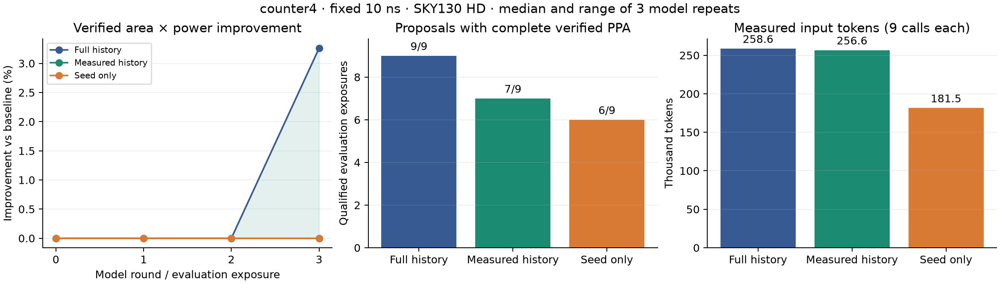

# Measured context-policy search comparison

This report compares full history, measured history without earlier model interpretations, and seed-only context. Each policy has three independent model repetitions and three measured feedback rounds on counter4. It measures this context ablation, not all possible effects of the agent update.

**Observed result:** full history reached an improved verified objective in **3/3** repetitions, measured history in **1/3**, and seed-only in **0/3**. The reduced-context policies did not outperform full history in this experiment. This is not evidence that forgetting cannot help on other tasks or longer searches.

| Policy | Valid responses | Qualified proposals | Repeated proposals in own branch | Unique proposed configs | Input tokens | Model wall time (s) | Final area × power improvement: median [range] |
| --- | ---: | ---: | ---: | ---: | ---: | ---: | ---: |
| full_history | 9/9 | 9/9 | 0/9 | 3 | 258622 | 104.0 | 3.260% [3.260, 3.260] |
| fresh_evidence | 9/9 | 7/9 | 0/9 | 4 | 256587 | 134.8 | 0.000% [0.000, 3.260] |
| seed_only | 9/9 | 6/9 | 0/9 | 4 | 181465 | 121.0 | 0.000% [0.000, 0.000] |

Baseline: **290.278 µm² cell area**, **124.000 µW activity-annotated power**, **480.461 µm² core area**, **6.094356 ns worst setup slack**, at fixed 10 ns clock. The two initial candidates were measured in this same frozen provenance cohort. Only their nondominated measured seed is retained initially.

Best measured configuration: **{'FP_CORE_UTIL': 35, 'SYNTH_STRATEGY': 'AREA 3'}** (`ctx17-full-history-p3-r3`). Cell area changed to **287.776 µm² (-0.862%)** and activity power to **121.000 µW (-2.419%)**, giving **3.260% lower cell-area × power**. **Core area increased to 653.126 µm² (+35.937%)**. Worst setup slack changed by **+0.025010 ns**; setup/hold WNS remain zero. This is a measured tradeoff, not an improvement in every PPA/floorplan metric.

Actual work: **27 model calls**, **7 unique full-flow evaluations including two baselines**. A configuration shared by several policies is executed once and its exact measured result is reused. Each proposing branch is charged one evaluation exposure. The actual tool-execution count therefore differs from the 27 model opportunities. Unique-configuration counts are within each policy across its three repetitions; own-branch repeat counts compare against that repetition's earlier measured candidates, including baselines.

## Final selected candidates by repetition

| Policy / repetition | Candidate | Cell area (µm²) | Activity power (µW) | Core area (µm²) | Worst setup slack (ns) |
| --- | --- | ---: | ---: | ---: | ---: |
| full_history / 1 | ctx17-full-history-p3-r3 | 287.776 | 121.000 | 653.126 | 6.119366 |
| full_history / 2 | ctx17-full-history-p3-r3 | 287.776 | 121.000 | 653.126 | 6.119366 |
| full_history / 3 | ctx17-full-history-p3-r3 | 287.776 | 121.000 | 653.126 | 6.119366 |
| fresh_evidence / 1 | ctx17-fresh-evidence-p3-r2 | 290.278 | 124.000 | 480.461 | 6.094356 |
| fresh_evidence / 2 | ctx17-full-history-p3-r3 | 287.776 | 121.000 | 653.126 | 6.119366 |
| fresh_evidence / 3 | ctx17-fresh-evidence-p3-r2 | 290.278 | 124.000 | 480.461 | 6.094356 |
| seed_only / 1 | ctx17-fresh-evidence-p3-r2 | 290.278 | 124.000 | 480.461 | 6.094356 |
| seed_only / 2 | ctx17-fresh-evidence-p3-r2 | 290.278 | 124.000 | 480.461 | 6.094356 |
| seed_only / 3 | ctx17-fresh-evidence-p3-r2 | 290.278 | 124.000 | 480.461 | 6.094356 |

## What the comparison establishes

PPA ranking includes only candidates with complete matching provenance, final Magic/KLayout DRC and LVS, all reported timing corners and electrical/antenna gates, nonvacuous RTL-to-synthesis and synthesis-to-final proofs, and the independent counter testbench. Failed, missing and deferred outcomes never contribute invented zero metrics. The power values are activity-annotated extracted-parasitic OpenSTA analysis at ff_n40C_1v95, not laboratory measurements.

Compare individual paired repetitions and their range in `analysis.json`. Three model repeats on one small design do not establish statistical superiority or predict a larger design's behavior. Physical results are shared cache observations, without an independent physical noise estimate. A zero observed gain means none within this experiment's candidate space, rounds and precision; it is not proof that further improvement is impossible. The best-objective trajectory retains the baseline, so a bad proposal does not erase an already verified result.

All calls use the same gpt-6.1-sol/high settings, fresh tool-disabled sessions, and the frozen candidate domain. Full history replays each preceding response once alongside measured records; measured history removes these interpretations; seed-only exposes retained seeds. Schedule seed 42 controls trial order, not unavailable model generation randomness. Input/output/reasoning usage and model wall time are measured; monetary billing is unavailable. Cached token counts are reported separately. Model latency includes CLI overhead and provider effects; cached physical runtimes cannot establish per-policy tool speedups.

The conditional stagnation trigger is observational here: fixed visibility assignments remain in place. Multiple nondominated seeds are retained only when measurements supply them. This experiment does not independently attribute gains to adaptive triggering or prove optimal seed diversity.

## Evidence

- `protocol.json`: declared hypotheses, domain, schedule seed and shared budgets.
- `user-authorization.json`: user-approved external inference scope; `approval-scope.json` preserves the original request.
- `frozen-inputs.json` and `frozen-sources/`: exact source hashes, observed tool versions and image digest.
- `trials/`: each prompt, exact model command/events, response and measured usage.
- `physical/`: validated run specs, raw results, console logs and final proof logs. Original native runs remain in `../../runs/` relative to this report's directory. Separately retained RTL-to-synthesis proof retries preserve their own results/logs and do not overwrite original measurement rows.
- `analysis.json`: audited trial mappings, paired differences, overlaps, trajectories, per-candidate metrics and limitations.
- `evidence-manifest.json`: final file-integrity inventory. Integrity alone does not establish a signoff verdict.
